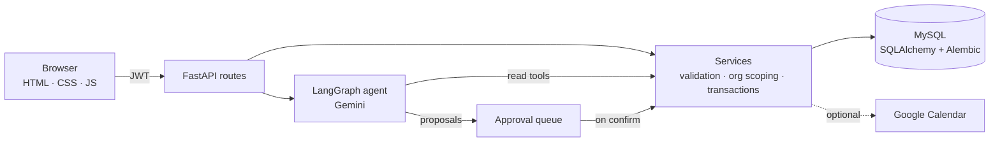

<div align="center">

# SalesDesk

**AI Sales Intelligence & CRM System**

_The assistant reads everything. It writes nothing you haven't approved._


</div>

---

Most CRMs store what happened. They don't tell you what to do next, and if they do, you can't
see why.

SalesDesk is a full-stack CRM for customers, sales leads, meetings, calls and follow-ups. It has
a ranked list of recommended actions, and every recommendation shows the evidence behind it.
It also has a Gemini-powered assistant that answers from your real CRM records. When the
assistant wants to change something, it proposes the change and waits for a person to approve
it.

It is one FastAPI application backed by MySQL, with a plain HTML/CSS/JavaScript interface and no
separate frontend build step.

## What it does

**Customer workspace.** Register a customer, their company, a primary contact and the first
sales lead in one transaction. Search and page through customers, then open one to see
contacts, sales leads and a filterable timeline of every meeting, call and follow-up.

**Sales leads and pipeline.** The Sales leads page (`/leads`) lists every lead with search,
filters and pagination. A lead belongs to an existing customer and can link one of its contacts,
an assigned sales rep, a lead source, an estimated value and an expected close date. Two
separate fields track it: *qualification* (`Ready` / `Not Ready`, new leads start Not Ready) and
*outcome* (`Won` / `Lost`, empty while open). Marking a lead Not Ready can schedule its next
follow-up in the same step. Only a Ready, open lead is an active opportunity, and only it can be
closed; closing records the outcome and time (and a required loss reason for Lost) and makes the
lead read-only. There is no reopen. Leads are stored in the `sales_enquiries` table and the
`/api/enquiries` routes are unchanged, so existing integrations keep working.

**Shared scheduling.** Meetings, scheduled calls and active follow-ups share one calendar per
workspace. New bookings are checked for conflicts, alternative slots within business hours are
suggested, and times are shown in the user's timezone. Details are in
[docs/scheduling.md](docs/scheduling.md).

**Recommended actions.** The analytics page ranks what needs attention: overdue follow-ups,
stalled deals, neglected leads and customers with no next step. Fixed rules produce the
ranking, not the language model. Every item carries a 0–100 priority score, its evidence (each
point marked _fact_, _estimate_ or _missing data_), and links to the exact enquiry, follow-up or
meeting.

**Analytics.** KPIs, distributions, pipeline value by stage, activity trends and follow-up due
windows. Database queries calculate every number; the model never does arithmetic.

**AI assistant.** Ask about a customer, prepare for a meeting, or ask what to focus on. You can
also generate a customer summary or a meeting brief on demand.

**Approvals (human in the loop).** When the assistant proposes a meeting, a follow-up, a
scheduled call, a call result, a completed follow-up or a field enrichment, the proposal waits
on the customer page with **Confirm** and **Cancel** buttons. Administrators can set each action
type to `approval_required` (the default), `automatic` or `disabled`, and every policy change is
audited.

**Excel import.** Upload a `.xlsx` workbook with `Companies`, `Customers`, `Contacts`,
`Sales_Enquiries`, `Meetings`, `Calls`, `Follow_Ups` and `TEST_EXPECTATIONS` sheets. Sheets,
columns and cross-references are validated first, and the whole import runs in one transaction,
so a failure rolls everything back. `Sales_Enquiries` (sales leads) may add an optional
`lead_source` column; rows without one are recorded as `import`. Imported leads start Not Ready.

**Google Calendar sync (optional).** Each user can connect their own Google Calendar from
Settings. CRM activities are then mirrored as calendar events, and failed syncs can be retried.
The integration stays off until it is configured.

**Organisation isolation.** Every CRM record belongs to an organisation. Services filter by the
signed-in user's organisation; records in another organisation return `404`. Composite foreign
keys and a session-level guard also stop records from referencing another organisation's data.

## How it works



The application has three layers. **Routes** handle HTTP and authentication. **Services** hold
the business rules: validation, organisation scoping, scheduling conflicts and transactions.
**Models** map to MySQL, and Alembic migrations manage the schema; the app never calls
`create_all`.

The browser and the assistant use the same services. When the assistant reads a customer, it
uses the same code that serves the customer page.

### The assistant, in plain terms

The assistant is a LangGraph agent running Gemini. It cannot query the database directly; it
can only call a fixed set of tools:

| Kind | Tools |
| --- | --- |
| Read | `find_customer`, `find_sales_leads`, `get_customer_profile`, `get_sales_enquiries`, `get_customer_meetings`, `get_customer_calls`, `get_customer_followups`, `get_customer_activity`, `get_sales_analytics`, `get_proactive_insights`, `analyze_crm_activity` |
| Propose | `create_meeting`, `create_followup`, `schedule_call`, `record_call_result`, `complete_followup`, `apply_enrichment`, `update_lead_qualification`, `close_opportunity` |

`update_lead_qualification` and `close_opportunity` are approval-only: their policy can be
`approval_required` or `disabled`, never `automatic`.

Some rules hold for every conversation:

- **Grounded answers.** The assistant answers from tool results. For "what should I focus
  on?" it must call `get_proactive_insights` rather than rank records itself. It cites record
  IDs, and it says when evidence is only an estimate or data is missing.
- **Writes are proposals.** A proposal tool validates the request and stores a pending action.
  Nothing changes in the CRM until a person confirms it, unless an administrator has set that
  action type to `automatic`.
- **Scoped.** On a customer page, the tools refuse records belonging to other customers. A
  proposal can only reference records the assistant has already looked up.
- **Bounded.** AI routes are rate-limited per user, tool loops have a recursion limit, and
  pending proposals expire after `AGENT_ACTION_TTL_SECONDS`.
- **Optional.** Without a `GEMINI_API_KEY`, the rest of the CRM works normally. AI endpoints
  return `503 llm_not_configured`.

## Quick start (Windows PowerShell)

**Requirements:** Python 3.11 and MySQL 8.

```powershell
git clone <your-fork-url> salesdesk
cd salesdesk

python -m venv .venv
.\.venv\Scripts\Activate.ps1
python -m pip install -r requirements.txt

Copy-Item .env.example .env   # then edit .env (see Configuration)
```

Create an empty database and an application account in MySQL:

```sql
CREATE DATABASE ai_sales_crm CHARACTER SET utf8mb4 COLLATE utf8mb4_0900_ai_ci;
CREATE USER 'crm_app'@'localhost' IDENTIFIED BY '<strong password>';
GRANT ALL PRIVILEGES ON ai_sales_crm.* TO 'crm_app'@'localhost';
```

Apply the migrations, then start the server:

```powershell
python -m alembic upgrade head
python -m uvicorn app.main:app --reload
```

Open <http://127.0.0.1:8000>. To check the server, use `GET /health`. To check the database
connection too, use `GET /health/ready`. Interactive API docs are at `/docs` when
`ENVIRONMENT` is not `production`.

### Create the first user

There is no signup flow yet (see [Limitations](#limitations)), so the first account is created
directly in the database. First generate a password hash:

```powershell
python -c "from getpass import getpass; from app.core.security import hash_password; print(hash_password(getpass()))"
```

Then insert the user into the default workspace, which the migrations create:

```sql
INSERT INTO users (email, full_name, password_hash, role, is_active, organization_id)
SELECT 'admin@example.com', 'Admin', '<hash from above>', 'admin', 1, organization_id
FROM organizations WHERE slug = 'default-workspace';
```

Sign in at `/login`. Use `role = 'sales'` for everyone who doesn't need to change approval
policies.

## Configuration

All settings come from environment variables or `.env`, and environment variables take
precedence. [.env.example](.env.example) lists them all. These are the main ones:

| Variable | Purpose |
| --- | --- |
| `ENVIRONMENT` | `production` turns on the strict checks under [Security](#security) and hides `/docs` |
| `DB_HOST` `DB_PORT` `DB_NAME` `DB_USER` `DB_PASSWORD` | MySQL connection |
| `JWT_SECRET_KEY` | Token signing key; must be at least 32 characters in production |
| `CORS_ALLOWED_ORIGINS` | Explicit list of allowed origins |
| `GEMINI_API_KEY` `GEMINI_MODEL` | Enable the assistant (default model `gemini-2.5-flash`) |
| `AGENT_ACTION_TTL_SECONDS` | Lifetime of a pending proposal (30–3600 seconds, default 300) |
| `ALLOW_PUBLIC_REGISTRATION` | Keep `false` until signup creates organisations |
| `GOOGLE_CLIENT_ID` `GOOGLE_CLIENT_SECRET` `GOOGLE_REDIRECT_URI` `GOOGLE_TOKEN_ENCRYPTION_KEY` | Google Calendar sync; enabled only when all four are set and the key is a valid Fernet key |
| `SCHEDULING_*` | Business hours, slot increments, default durations and the suggestion window |

To generate a Fernet key for `GOOGLE_TOKEN_ENCRYPTION_KEY`:

```powershell
python -c "from cryptography.fernet import Fernet; print(Fernet.generate_key().decode())"
```

> In PowerShell, `$env:NAME = ""` **removes** the variable instead of blanking it, so the value
> in `.env` applies again. To override a setting for one session, set a real value.

## Migrations

```powershell
python -m alembic current       # show the applied revision
python -m alembic upgrade head  # apply pending migrations
```

Migration `20261013_0013` adds organisation scoping to existing data. Before running it against
a database that holds real data, follow [docs/migration_0013_runbook.md](docs/migration_0013_runbook.md).
It covers the backup, a rehearsal on a restored copy, preflight checks, interruption recovery
and rollback. The migration is resumable, refuses offline `--sql` mode, and stops if any row
count changes.

Migration `20261013_0014` adds the lead fields to `sales_enquiries` (contact, assigned rep,
lead source, expected close date, qualification, outcome, closed time, loss reason) and allows
the two new assistant actions. Every new column is nullable or defaulted: existing leads become
Not Ready with no outcome, and nothing is inferred from their old status. Back up first.

## Tests

```powershell
python -m pytest -q
```

By default the suite uses in-memory SQLite and mocked chat models, so it touches neither your
MySQL database nor Gemini. The MySQL-specific tests for migrations and scheduling locks are
skipped unless you point them at a **disposable** schema:

```powershell
$env:MYSQL_TEST_URL = "mysql+pymysql://<user>:<password>@127.0.0.1:3306/ai_sales_crm_test"
python -m pytest -q tests/test_organization_migration.py tests/test_scheduling_mysql.py
```

These tests drop every table in that schema and refuse to run against any schema not named
`ai_sales_crm_test`.

## API reference

All endpoints are under `/api` and require a bearer token, except `/api/auth/*` and the Google
OAuth callback. Interactive documentation is at `/docs`.

<details>
<summary><b>Auth</b></summary>

| Method | Endpoint | Purpose |
| --- | --- | --- |
| `POST` | `/api/auth/login` | Exchange email and password for a JWT |
| `GET` | `/api/auth/me` | Current user |
| `POST` | `/api/auth/register` | Self-registration (disabled by `ALLOW_PUBLIC_REGISTRATION=false`) |

</details>

<details>
<summary><b>Customers, contacts and sales leads</b></summary>

| Method | Endpoint | Purpose |
| --- | --- | --- |
| `POST` | `/api/customers` | Register customer, company, primary contact and first sales lead together |
| `GET` | `/api/customers` | List customers: `search`, `customer_name`, `company_name`, `page`, `page_size` (≤ 100) |
| `GET` `PUT` `PATCH` | `/api/customers/{customer_id}` | Read or update a customer |
| `GET` | `/api/customers/{customer_id}/overview` | Profile with all activity |
| `GET` | `/api/customers/{customer_id}/activity` | Timeline: `type`, `start_date`, `end_date` (inclusive) |
| `POST` | `/api/contacts` | Add a contact |
| `GET` `PUT` `PATCH` | `/api/contacts/{contact_id}` | Read or update a contact |
| `GET` | `/api/customers/{customer_id}/contacts` | A customer's contacts |
| `GET` | `/api/enquiries` | List sales leads: `search`, `qualification_status` (`ready`/`not_ready`), `outcome` (`open`/`won`/`lost`), `customer_id`, `assigned_user_id`, `page`, `page_size` |
| `POST` | `/api/enquiries` | Create a sales lead (starts `not_ready` unless set) |
| `GET` `PUT` `PATCH` | `/api/enquiries/{enquiry_id}` | Read or update a sales lead; closed opportunities return `409 opportunity_closed` |
| `POST` | `/api/enquiries/{enquiry_id}/qualification` | Set Ready / Not Ready with a reason; Not Ready may add `next_followup` |
| `POST` | `/api/enquiries/{enquiry_id}/close` | Close a Ready, open lead as `won` or `lost` (`loss_reason` required for lost) |
| `GET` | `/api/enquiries/assignees` | Active users a lead can be assigned to |
| `GET` | `/api/customers/{customer_id}/enquiries` | A customer's sales leads |
| `POST` | `/api/import` | Import a `.xlsx` workbook |

Example registration body:

```json
{
  "customer_name": "Ada Lovelace",
  "status": "active",
  "sales_stage": "qualified",
  "company": {"company_name": "Analytical Engines Ltd"},
  "primary_contact": {"name": "Ada Lovelace", "email": "ada@example.com"},
  "sales_enquiry": {
    "enquiry_text": "Interested in a team subscription.",
    "priority": "high",
    "status": "open",
    "estimated_value": "1250.50"
  }
}
```

</details>

<details>
<summary><b>Meetings, calls, follow-ups and scheduling</b></summary>

| Method | Endpoint | Purpose |
| --- | --- | --- |
| `POST` | `/api/meetings` | Schedule a meeting |
| `GET` `PUT` | `/api/meetings/{meeting_id}` | Read or update a meeting |
| `GET` | `/api/customers/{customer_id}/meetings` | A customer's meetings |
| `POST` | `/api/calls` | Log or schedule a call |
| `GET` `PUT` | `/api/calls/{call_id}` | Read or update a call |
| `GET` | `/api/customers/{customer_id}/calls` | A customer's calls |
| `POST` | `/api/followups` | Create a follow-up |
| `GET` `PUT` | `/api/followups/{followup_id}` | Read or update a follow-up |
| `GET` | `/api/customers/{customer_id}/followups` | A customer's follow-ups |
| `GET` | `/api/scheduling/activities` | Everything on the shared calendar |
| `POST` | `/api/scheduling/availability` | Check a slot and get alternatives |
| `POST` | `/api/scheduling/activities/{activity_type}/{record_id}/move` | Move an activity to another date |

</details>

<details>
<summary><b>Analytics and recommendations</b></summary>

| Method | Endpoint | Purpose |
| --- | --- | --- |
| `GET` | `/api/analytics/overview` | Headline KPIs |
| `GET` | `/api/analytics/customers` | Status, stage and industry distributions; creation trend |
| `GET` | `/api/analytics/enquiries` | Status, priority and product distributions; value; trend |
| `GET` | `/api/analytics/activities` | Activity trend and status distributions |
| `GET` | `/api/analytics/pipeline` | Enquiry count and value by sales stage |
| `GET` | `/api/analytics/followups` | Follow-up states and due windows |
| `GET` | `/api/analytics/attention` | Dashboard "Needs attention" queue |
| `GET` | `/api/analytics/proactive-insights` | Ranked recommendations: `category`, `urgency`, `min_score`, `customer_id`, `page`, `page_size` |

Metric endpoints accept inclusive `start_date` and `end_date` parameters. The customers,
enquiries and activities endpoints also take `grain` (`daily`, `weekly` or `monthly`).

**How a recommendation is scored.** Urgency combines overdue time, inactivity and an imminent
meeting. Impact combines enquiry priority, sales stage and estimated value. The priority score
is 60% urgency plus 40% impact, with up to 15 bonus points for multiple signals, capped at 100.
A score of 60 or more is _high_, and 30 or more is _medium_. All thresholds are in the `RULES`
dictionary in
[app/services/proactive_insights_service.py](app/services/proactive_insights_service.py).

</details>

<details>
<summary><b>Assistant and approvals</b></summary>

| Method | Endpoint | Purpose |
| --- | --- | --- |
| `POST` | `/api/agent/chat` | Send a message, optionally scoped to a customer |
| `GET` | `/api/agent/conversations/latest` | Restore the latest chat for a customer |
| `GET` `POST` | `/api/agent/customer-summary/{customer_id}` | AI customer summary |
| `GET` `POST` | `/api/agent/meeting-brief/{meeting_id}` | AI meeting preparation brief |
| `POST` | `/api/agent/actions/{action_id}/confirm` | Approve and execute a proposal |
| `POST` | `/api/agent/actions/{action_id}/cancel` | Cancel a proposal |
| `POST` | `/api/agent/actions/{action_id}/reject` | Reject a proposal |
| `POST` `GET` | `/api/agent/tasks` | Create or list structured tasks that need human input |
| `GET` | `/api/agent/tasks/{task_id}` | Resume a task |
| `POST` | `/api/agent/tasks/{task_id}/inputs` | Supply the requested information |
| `POST` | `/api/agent/tasks/{task_id}/cancel` | Cancel a task |
| `GET` | `/api/agent/policies` | Current autonomy policy per action type |
| `PUT` | `/api/agent/policies/{action}` | Change a policy (admin only, audited) |

</details>

<details>
<summary><b>Google Calendar</b></summary>

| Method | Endpoint | Purpose |
| --- | --- | --- |
| `GET` | `/api/integrations/google-calendar` | Connection status |
| `POST` | `/api/integrations/google-calendar/connect` | Start the OAuth flow |
| `DELETE` | `/api/integrations/google-calendar` | Disconnect and revoke |
| `PUT` | `/api/integrations/google-calendar/preferences` | Reminder preferences |
| `POST` | `/api/integrations/google-calendar/retry` | Retry failed syncs |

</details>

## Security

- **Authentication.** Passwords are hashed with Argon2, sessions use signed JWTs, and every CRM
  route requires a valid token.
- **Tenant isolation.** Every query is filtered by the user's organisation. Composite foreign
  keys and an ORM flush guard stop records from referencing another organisation's data.
- **Production checks.** When `ENVIRONMENT=production`, startup fails if the JWT secret is
  shorter than 32 characters or CORS allows `*` or localhost. Public registration is also
  refused unless `ALLOW_PUBLIC_REGISTRATION_IN_PRODUCTION=true` is set explicitly. API docs are
  disabled.
- **AI guardrails.** The model has no SQL access, writes require approval by default, and AI
  endpoints are rate-limited.
- **Secrets.** OAuth tokens are encrypted at rest with Fernet. Never commit `.env`, database
  dumps or customer data.
- **Deletion.** Deleting a company or customer is blocked while related records exist. Optional
  links from activities use `ON DELETE SET NULL`, so activity history is kept.

## Limitations

- **No signup yet.** `POST /api/auth/register` does not create an organisation, so it fails
  while the new user has none. Keep `ALLOW_PUBLIC_REGISTRATION=false` and create users as shown
  above.
- **Email verification** fields are stored but not enforced.
- **Single process.** Rate limits and LangGraph checkpoints live in process memory. They are
  lost on restart and not shared between workers.
- **Meeting-to-proposal conversion** is reported as unavailable, because the schema doesn't
  record a proposal outcome per meeting.
- **Rule-based recommendations.** They depend on the data entered: a lead with no logged
  activity is measured from its creation date. They suggest priorities; they don't predict
  outcomes.
- **No screenshots or hosted demo** yet. Run it locally to see the interface.

## Project layout

```text
app/
  api/routes/     HTTP endpoints
  services/       business rules, scoping, scheduling, insights, calendar sync
  models/         SQLAlchemy models and the tenant guard
  schemas/        Pydantic request and response models
  agent/          LangGraph agent, prompts and tools
  frontend/       HTML, CSS and JavaScript served by FastAPI
alembic/          schema migrations
docs/             scheduling notes and the 0013 migration runbook
scripts/rehearsal/  helpers for rehearsing migrations on a disposable schema
tests/            pytest suite
```
